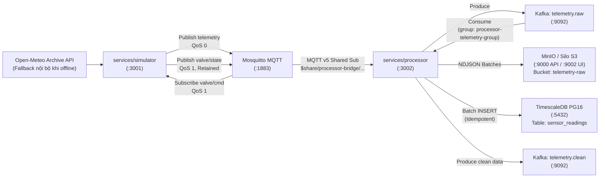

# Hướng dẫn Kỹ thuật, Khởi chạy & Kết nối — Role A (Data & Pipeline)

Tài liệu này hướng dẫn chi tiết cách cài đặt, cấu hình môi trường, khởi chạy hạ tầng local, vận hành hai microservice của Role A (`@digital-twin/simulator`, `@digital-twin/processor`), quản lý cơ sở dữ liệu TimescaleDB và gọi các API điều khiển kịch bản phục vụ kiểm thử / quay demo.

---

## 1. Sơ đồ luồng kết nối thực tế



---

## 2. Yêu cầu cài đặt & Khởi chạy nhanh (Quick Start)

### 2.1. Công cụ cần có trên máy
- **Node.js** >= 20 (khuyến nghị Node 22 hoặc 24 LTS) và **npm** >= 10.
- **Docker Desktop** (đã bật daemon).

### 2.2. Các bước chạy toàn bộ luồng dữ liệu từ đầu

**Bước 1 — Cài đặt dependencies ở thư mục gốc monorepo:**
```bash
npm install
```

**Bước 2 — Tạo file biến môi trường `.env` (chỉ nằm trên máy local, không commit lên Git):**
```bash
# Trên PowerShell (Windows):
Copy-Item .env.example .env
# Mở file .env và đổi POSTGRES_PASSWORD, MINIO_ROOT_PASSWORD thành mật khẩu local tùy chọn
```

**Bước 3 — Bật 4 container hạ tầng (`Mosquitto`, `TimescaleDB`, `Kafka KRaft`, `MinIO`):**
```bash
npm run infra:up
```
Kiểm tra cả 4 container đều lên trạng thái `(healthy)`:
```bash
docker ps
```

**Bước 4 — Chạy SQL Migrations & nạp dữ liệu khởi tạo (Seed):**
```bash
npm run db:setup
```
*(Lệnh này hoàn toàn idempotent — chạy lại nhiều lần không gây lỗi trùng dữ liệu).*

**Bước 5 — Khởi chạy `processor` và `simulator` ở 2 cửa sổ terminal riêng:**
```bash
# Terminal 1: Khởi chạy bộ thu thập & làm sạch dữ liệu
npm run dev:processor

# Terminal 2: Khởi chạy bộ mô phỏng nông trại & van tưới ảo
npm run dev:simulator
```

**Khi ngừng làm việc (tắt gọn các container Docker):**
```bash
npm run infra:down
```

---

## 3. Danh sách Cổng (Ports) & Giao diện truy cập Local

| Thành phần | Container / Package | Cổng Host | Giao thức / Công dụng |
|---|---|---|---|
| **Mosquitto** | `dtf-mosquitto` | `1883` | Giao thức MQTT v3.1.1 / v5.0 |
| **TimescaleDB** | `dtf-timescaledb` | `5432` | PostgreSQL 16 + TimescaleDB |
| **Apache Kafka** | `dtf-kafka` | `9092` (host) / `29092` (nội bộ Docker) | Kafka Broker (chế độ KRaft không cần ZooKeeper) |
| **MinIO S3 API** | `dtf-minio` | `9000` | Cổng S3 API để `processor` upload file `.ndjson` |
| **MinIO Web UI** | `dtf-minio` | `9002` | Mở `http://localhost:9002` trên trình duyệt để xem bucket `telemetry-raw` |
| **Simulator** | `@digital-twin/simulator` | `3001` | HTTP probes (`/healthz`, `/readyz`, `/metrics`) & API kịch bản |
| **Processor** | `@digital-twin/processor` | `3002` | HTTP probes (`/healthz`, `/readyz`, `/metrics`) & API trạng thái buffer |

> **Lưu ý quan trọng cho Role C khi dựng Docker/Helm:**
> Kho image gốc `minio/minio:latest` và `quay.io/minio/minio:latest` đã khóa quyền pull ẩn danh (trả về lỗi `401 Unauthorized` / `pull access denied`). Trong `deploy/docker-compose.dev.yml`, hệ thống sử dụng image thay thế tương thích 100% chuẩn S3 & giao diện MinIO là **`pgsty/silo:latest`**.

---

## 4. Bảng Biến môi trường (Environment Variables)

Cả hai service đều cấu hình **100% qua biến môi trường** (không hardcode mật khẩu trong mã nguồn).

### 4.1. Biến môi trường của `services/simulator`

| Biến môi trường | Mặc định | Ý nghĩa |
|---|---|---|
| `PORT` (hoặc `SIMULATOR_PORT`) | `3001` | Cổng HTTP của Simulator |
| `SIMULATOR_FARM_ID` | `farm-01` | Mã nông trại phát lên MQTT |
| `SIMULATOR_LATITUDE` | `11.9404` | Vĩ độ lấy thời tiết Open-Meteo (mặc định Lâm Đồng) |
| `SIMULATOR_LONGITUDE` | `108.4583` | Kinh độ lấy thời tiết Open-Meteo |
| `MQTT_BROKER_URL` | `mqtt://localhost:1883` | Địa chỉ kết nối MQTT Broker |
| `MQTT_USERNAME` / `MQTT_PASSWORD` | *(trống)* | Thông tin xác thực MQTT (khi Role C bật bảo mật) |
| `SIMULATOR_ZONE_COUNT` | `4` | Số phân khu mô phỏng (`zone-A`..`zone-D`) |
| `SIMULATOR_VIRTUAL_SENSORS_PER_ZONE` | `0` | Số cảm biến ảo nhân bản thêm mỗi zone. Đặt `125` sẽ tạo `4 × (4 + 125) = 516` cảm biến phục vụ Load Test |
| `SIMULATOR_TICK_INTERVAL_MS` | `5000` | Chu kỳ phát dữ liệu cảm biến (mili-giây thực) |
| `SIMULATOR_PHYSICS_MINUTES_PER_TICK` | `5` | Số phút vật lý trôi qua mỗi nhịp (lưu ý: trường `ts` gửi đi luôn là đồng hồ thực UTC để khớp Grafana & đo latency) |
| `SIMULATOR_DROUGHT_MODE` | `false` | Khởi động sẵn ở chế độ hạn hán hay không |
| `SIMULATOR_WEATHER_ENABLED` | `true` | Bật/tắt gọi API lịch sử Open-Meteo (`false` sẽ dùng hàm chu kỳ ngày/đêm nội bộ) |
| `SIMULATOR_ALT_UNIT_PROBABILITY` | `0.05` | Xác suất phát đơn vị thay thế (`%`, `°F`, `klux`) để kiểm chứng tầng chuẩn hóa của Processor |
| `SIMULATOR_RANDOM_FAULT_RATE` | `0.005` | Xác suất xảy ra sự cố ngẫu nhiên tức thời trên mỗi nhịp đọc |

### 4.2. Biến môi trường của `services/processor`

| Biến môi trường | Mặc định | Ý nghĩa |
|---|---|---|
| `PORT` (hoặc `PROCESSOR_PORT`) | `3002` | Cổng HTTP của Processor |
| `MQTT_BROKER_URL` | `mqtt://localhost:1883` | Địa chỉ MQTT Broker |
| `MQTT_USERNAME` / `MQTT_PASSWORD` | *(trống)* | Thông tin xác thực MQTT |
| `PROCESSOR_MQTT_SHARED_GROUP` | `processor-bridge` | Tên nhóm MQTT v5 Shared Subscription chống trùng bản tin khi chạy nhiều Pod |
| `KAFKA_BROKERS` | `localhost:9092` | Danh sách Kafka brokers (cách nhau bằng dấu phẩy) |
| `KAFKA_CLIENT_ID` | `dtf-processor` | Định danh Kafka client |
| `PROCESSOR_CONSUMER_GROUP` | `processor-telemetry-group` | Consumer group đọc `telemetry.raw` |
| `PROCESSOR_KAFKA_PARTITIONS` | `4` | Số partitions khi tự khởi tạo Kafka topics |
| `POSTGRES_HOST` / `POSTGRES_PORT` | `localhost` / `5432` | Địa chỉ kết nối TimescaleDB |
| `POSTGRES_DB` / `POSTGRES_USER` | `digital_twin_farm` / `twin_user` | Tên DB và tài khoản DB |
| `POSTGRES_PASSWORD` | *(bắt buộc)* | Mật khẩu kết nối TimescaleDB |
| `PROCESSOR_BATCH_SIZE` | `50` | Kích thước lô gom ghi vào bảng `sensor_readings` |
| `PROCESSOR_FLUSH_INTERVAL_MS` | `1000` | Chu kỳ tối đa xả buffer xuống TimescaleDB (ms) |
| `PROCESSOR_MINIO_ENABLED` | `true` | Bật/tắt lưu trữ lạnh bản thô lên MinIO |
| `MINIO_ENDPOINT` / `MINIO_PORT` | `localhost` / `9000` | Địa chỉ S3 API của MinIO |
| `MINIO_USE_SSL` | `false` | Sử dụng HTTPS cho MinIO hay không |
| `MINIO_ROOT_USER` / `MINIO_ROOT_PASSWORD` | `minio_admin` / *(bắt buộc khi bật MinIO)* | Access Key & Secret Key của MinIO |
| `MINIO_RAW_BUCKET` | `telemetry-raw` | Tên bucket lưu trữ các file `.ndjson` thô |
| `PROCESSOR_STUCK_THRESHOLD_COUNT` | `5` | Số chu kỳ liên tiếp giá trị đứng im để gắn cờ `stuck` |
| `PROCESSOR_MISSING_SIGNAL_TIMEOUT_MS` | `20000` | Thời gian chờ tối đa (ms) trước khi phát cờ `missing_signal` |

---

## 5. Các HTTP API Điều khiển & Kiểm tra (Phục vụ Demo & Vận hành)

### 5.1. Endpoints bắt buộc trên cả 2 service (`:3001` và `:3002`)
- `GET /healthz` — Liveness probe cho Kubernetes (`200 OK`).
- `GET /readyz` — Readiness probe (`200 OK` khi kết nối hạ tầng sẵn sàng, `503` khi mất kết nối).
- `GET /metrics` — Xuất Prometheus metrics chuẩn (`prom-client`).

### 5.2. API Điều khiển kịch bản nóng trên Simulator (`http://localhost:3001`)

Không cần tắt/bật lại container khi quay video demo — dùng trực tiếp các API sau:

1. **Xem trạng thái vật lý thực tế của 4 zone, thời tiết & van tưới:**
   ```bash
   curl http://localhost:3001/simulation/state
   ```
2. **Bật / tắt kịch bản hạn hán (Drought Mode):**
   ```bash
   curl -X POST http://localhost:3001/simulation/scenario \
     -H "Content-Type: application/json" \
     -d "{\"droughtMode\": true}"
   ```
3. **Tiêm lỗi chủ động vào một cảm biến cụ thể (`out_of_range`, `stuck`, `dropout`, `drift`, hoặc `none`):**
   ```bash
   curl -X POST http://localhost:3001/simulation/faults \
     -H "Content-Type: application/json" \
     -d "{\"sensorId\": \"s-C-moisture\", \"mode\": \"out_of_range\"}"
   ```
   Xóa toàn bộ lỗi đã tiêm:
   ```bash
   curl -X POST http://localhost:3001/simulation/faults \
     -H "Content-Type: application/json" \
     -d "{\"clearAll\": true}"
   ```
4. **Đóng / mở thủ công van tưới (ngoài luồng MQTT tự động của Controller):**
   ```bash
   curl -X POST http://localhost:3001/simulation/valve \
     -H "Content-Type: application/json" \
     -d "{\"zoneId\": \"zone-B\", \"action\": \"open\", \"durationSec\": 45}"
   ```

### 5.3. API Quản trị trên Processor (`http://localhost:3002`)
- `GET http://localhost:3002/processor/status` — Xem trạng thái kết nối MQTT/Kafka/DB/MinIO, tổng số cảm biến đang theo dõi và số bản ghi chờ trong buffer.
- `POST http://localhost:3002/processor/flush` — Ép xả toàn bộ buffer trong RAM xuống TimescaleDB và MinIO ngay lập tức.

---

## 6. Đóng gói Docker Image & Kiểm thử tự động

### 6.1. Lệnh chạy kiểm thử và kiểm tra kiểu dữ liệu
```bash
npm run typecheck   # Kiểm tra TypeScript toàn monorepo + db scripts
npm run build       # Biên dịch shared, simulator, processor ra dist/
npm test            # Chạy toàn bộ 13 unit tests (shared + simulator + processor)
```

### 6.2. Build Docker Images (Build context đặt tại thư mục gốc repo `.`)
> **Lưu ý cho Role C (CI/CD & K8s):** Vì monorepo dùng gói nội bộ `@digital-twin/shared`, lệnh `docker build` bắt buộc đặt build context ở thư mục gốc `.` của repository:

```bash
docker build -f services/simulator/Dockerfile -t dtf-simulator:latest .
docker build -f services/processor/Dockerfile -t dtf-processor:latest .
```
