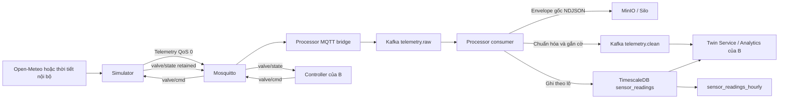

# Luồng simulator và bàn giao cho Role B

Phạm vi đối chiếu là nhánh `a/data-pipeline` tại commit `4c56514`, kiểm tra ngày 18/11/2026. [Kế hoạch Role A](project_assigning.md#4-role-a-data--pipeline) · [Kế hoạch Role B](project_assigning.md#5-role-b-twin-core) · [Hướng dẫn chạy Role A](role-a-technical-guide.md)

## 1. Role A đã đáp ứng đến đâu?

**Phần lõi của Role A đã chạy được end-to-end trên máy local**, từ simulator qua MQTT/Kafka tới TimescaleDB và MinIO, gồm cả vòng lệnh MQTT tới van và phản hồi trên dòng telemetry. Phần nghiệm thu còn lại tập trung vào k3s, đo tải kéo dài, nhiều replica, tích hợp Controller của Role B và báo cáo/demo.

| Mốc trong kế hoạch | Đối chiếu với repo | Mức xác minh |
|---|---|---|
| Tuần 1–2 · Hợp đồng, simulator 4 zone, pipeline và migration | Có schema Zod, tên topic, `farm-01` với 4 zone và 4 loại cảm biến mỗi zone. [Hợp đồng](../packages/shared/src/schemas.ts) · [Pipeline](../services/processor/src/kafkaPipeline.ts) | MQTT, Kafka và TimescaleDB đã nối thông trong lần chạy local. Việc cả nhóm duyệt hợp đồng cần xác nhận ngoài repo. |
| Tuần 3 · Hạn hán, seed, làm sạch và lỗi cảm biến | Có mô hình hạn hán, seed, chuẩn hóa đơn vị, lọc gai nhiễu EMA và cờ `out_of_range`, `stuck`, `missing_signal`. [Simulator](../services/simulator/src/domain/farmEngine.ts) · [Cleaner](../services/processor/src/domain/telemetryCleaner.ts) · [Seed](../db/seed/001_seed_default_farm.sql) | Unit test xác nhận hạn hán và các nhánh xử lý lỗi. Lần chạy local xác nhận seed, API hạn hán và cờ `out_of_range`/`missing_signal` trên Kafka và DB. |
| Tuần 4 · MinIO, retention, nén và đóng gói | Có bộ ghi NDJSON, SQL chính sách lưu trữ, Dockerfile cho hai service và Compose dev cho bốn dịch vụ hạ tầng. [Archive](../services/processor/src/repositories/rawArchiveRepository.ts) · [Migration](../db/migrations/002_init_sensor_readings_hypertable.sql) · [Compose dev](../deploy/docker-compose.dev.yml) | Đã đọc lại NDJSON từ MinIO, chạy thử chính sách TimescaleDB và build/chạy cả hai image trên Docker local. Repo chưa có chart hoặc manifest k3s. |
| Tuần 5 · Van tưới ảo và phối hợp closed loop | Simulator nhận lệnh MQTT, phát state, tác động lên độ ẩm và tự đóng van. [MQTT bridge](../services/simulator/src/mqttBridge.ts) · [Mô hình van](../services/simulator/src/domain/farmEngine.ts) | Đã gửi lệnh MQTT thật, nhận state retained và thấy độ ẩm tăng trên simulator lẫn Kafka. Vòng tự động từ Controller của Role B còn chờ tích hợp. |
| Tuần 6 · 500+ cảm biến và kịch bản lỗi | Cấu hình `SIMULATOR_VIRTUAL_SENSORS_PER_ZONE=125` tạo 516 cảm biến trên 4 zone. Có `dropout`, `stuck`, `out_of_range` và `drift`. [Sinh cảm biến](../services/simulator/src/domain/sensorGenerator.ts) | Đã ghi nhận đủ 516 sensor ID trên Kafka sạch và TimescaleDB trong lần chạy ngắn với một simulator và một processor. Đo tải kéo dài và hành vi nhiều replica còn chờ nghiệm thu. |
| Tuần 7–8 · Số liệu, báo cáo và demo | Có Prometheus counters và histogram đo thời gian từ `ts` tới lúc ghi TimescaleDB. Có tài liệu kỹ thuật và bàn giao. [Metrics](../services/processor/src/metrics.ts) · [Tài liệu bàn giao](role-a-handover-and-contracts.md) | Repo chưa có kết quả load test, biểu đồ throughput/latency, báo cáo cuối kỳ hoặc minh chứng demo. |

### Bằng chứng chạy local

- `npm run typecheck`, `npm test` (13/13), `npm run build`, kiểm tra Compose dev và `npm run db:setup` đều qua. Cả hai image chạy với `/healthz`, `/readyz`, `/metrics` trả HTTP 200. Histogram độ trễ của Processor có mẫu ghi nhận. Ở lần chạy image với 16 cảm biến, Simulator tải được 192 mẫu thời tiết theo giờ từ Open-Meteo cho giai đoạn 08–15/05/2025. API hạn hán đặt lượng mưa về 0 và độ ẩm tầng rễ zone B giảm trong các tick kế tiếp. [Danh sách lệnh](../package.json)
- Lần chạy ngắn khoảng 1 phút với 516 cảm biến và thời tiết fallback ghi được 4.637 dòng trong `sensor_readings`. Đã đọc và kiểm tra schema của một object MinIO chứa 100 envelope NDJSON. Lệnh mở van zone B 40 giây làm độ ẩm tầng rễ tăng từ 63,99% lên 66,20%. Subscriber MQTT vào sau nhận được trạng thái `open` retained, rồi Simulator phát `closed` sau khoảng 43,7 giây theo tick.
- Khi chạy thủ công các job TimescaleDB trên dữ liệu thử, chunk 35 ngày tuổi bị xóa, chunk 9 ngày tuổi được nén và tổng hợp giờ loại mẫu `out_of_range`. Chính sách 365 ngày của bảng tổng hợp đã được đăng ký trong DB.

## 2. Simulator sinh dữ liệu như thế nào?

Simulator khởi tạo nông trại từ preset trong code. Mặc định có `farm-01`, `zone-A` đến `zone-D`, 4 van và 16 cảm biến gốc. Mỗi tick chạy mỗi 5 giây thực và tiến 5 phút vật lý mô phỏng theo cấu hình mặc định. Trường `ts` của telemetry dùng giờ thực UTC. Thời lượng mở van tính theo giây thực và được kiểm tra vào đầu mỗi tick. [Vòng lặp](../services/simulator/src/index.ts) · [Cấu hình](../services/simulator/src/config.ts)

1. **Thời tiết.** `WeatherProvider` nạp nhiệt độ, độ ẩm không khí, mưa và bức xạ từ chuỗi lịch sử Open-Meteo. Nó giữ mẫu theo giờ trong RAM, phát lại tuần hoàn theo đồng hồ mô phỏng và nội suy giữa các mẫu. Khi tắt nguồn ngoài hoặc thiếu cache đủ dùng, simulator dùng mô hình ngày/đêm nội bộ. Bật hạn hán sẽ triệt mưa và tăng điều kiện bốc thoát hơi. [WeatherProvider](../services/simulator/src/domain/weatherProvider.ts)
2. **Vật lý mỗi zone.** `FarmEngine` cập nhật vi khí hậu và độ ẩm hai tầng đất. Mưa và tưới bổ sung nước vào tầng mặt. Nước dịch chuyển giữa tầng mặt và tầng rễ, mất đi qua bốc thoát hơi và thoát nước trọng lực. Cảm biến `soil_moisture` đọc tầng rễ. [FarmEngine](../services/simulator/src/domain/farmEngine.ts)
3. **Đo và phát.** `SensorGenerator` tạo độ ẩm đất (`percent`), nhiệt độ không khí (`celsius`), độ ẩm không khí (`percent`) và độ rọi (`lux`). Nó thêm nhiễu Gaussian, có thể đổi đơn vị trên bản thô, hoặc tiêm lỗi. `dropout` bỏ hẳn message, `stuck` giữ giá trị, `drift` tích lũy độ lệch và `out_of_range` phát số ngoài miền. Message thô khai `quality: "ok"`. Processor tính lại `quality`. [SensorGenerator](../services/simulator/src/domain/sensorGenerator.ts) · [MQTT bridge](../services/simulator/src/mqttBridge.ts)

## 3. Đường đi của dữ liệu

1. **MQTT → Kafka raw.** Simulator publish vào `farm/{farmId}/zone/{zoneId}/sensor/{sensorId}/telemetry` với QoS 0. MQTT bridge của Processor dùng MQTT v5 shared subscription `$share/processor-bridge/farm/+/zone/+/sensor/+/telemetry`. Bridge lấy ID từ topic, thêm `receivedAt` và giữ body gốc ở `rawPayload`, rồi ghi envelope vào `telemetry.raw` với key `zoneId`. [MQTT bridge](../services/processor/src/mqttIngestor.ts) · [Kafka pipeline](../services/processor/src/kafkaPipeline.ts)
2. **Kafka raw → lưu thô và làm sạch.** Consumer group mặc định `processor-telemetry-group` kiểm tra schema của envelope, đưa envelope hợp lệ vào hàng đợi MinIO, rồi kiểm tra JSON/schema của telemetry bên trong, chuẩn hóa đơn vị, lọc nhiễu và gắn cờ. Payload hỏng nhưng nằm trong envelope hợp lệ vẫn đủ điều kiện vào bản lưu thô. Payload JSON/schema/unit không hợp lệ dừng ở nhánh làm sạch. [Kafka pipeline](../services/processor/src/kafkaPipeline.ts) · [Cleaner](../services/processor/src/domain/telemetryCleaner.ts)
3. **Bản sạch → Kafka và TimescaleDB.** Processor đưa cùng record vào buffer của `sensor_readings` và publish vào `telemetry.clean` với key `zoneId`. Bản tin Kafka có thể tới Role B trước khi DB flush. Hai đầu ra không có giao dịch chung. Watchdog cũng phát `missing_signal` qua hai đầu ra này khi cảm biến đã được theo dõi im quá 20 giây mặc định. Watchdog quét mỗi 5 giây và dùng giá trị EMA gần nhất cho bản ghi đánh dấu. [Watchdog](../services/processor/src/index.ts) · [Kafka pipeline](../services/processor/src/kafkaPipeline.ts) · [Ghi DB](../services/processor/src/repositories/readingsRepository.ts)

## 4. Dữ liệu nằm ở đâu?

| Nơi lưu | Dữ liệu và vòng đời |
|---|---|
| RAM của Simulator | Trạng thái vật lý theo zone, thời tiết hiện tại, cache Open-Meteo, lỗi đang tiêm và trạng thái van. Khởi động lại sẽ dựng lại trạng thái từ preset và cấu hình. `GET /simulation/state` đọc trạng thái hiện tại. |
| Mosquitto · `mosquitto_data` | Telemetry QoS 0 đi qua broker. Bản `valve/state` gần nhất của mỗi zone được giữ theo topic (`retain: true`, QoS 1). Compose dev bật persistence cho broker. |
| Kafka · `kafka_data` | `telemetry.raw` chứa envelope gốc. `telemetry.clean` chứa record đã chuẩn hóa và có `quality`. Processor tạo topic `alerts` để Role B dùng. Thời hạn lưu Kafka theo cấu hình broker, repo không đặt retention riêng cho các topic. |
| RAM của Processor | Trạng thái theo dõi lỗi và EMA theo cảm biến, buffer ghi DB và buffer ghi MinIO. Các mục đang chờ flush có thể mất nếu process dừng đột ngột. |
| TimescaleDB · `timescaledb_data` | Database mặc định `digital_twin_farm`. `sensor_readings` lưu lịch sử từng mẫu và tất cả cờ chất lượng. Hypertable chia chunk theo ngày, cấu hình nén sau 7 ngày và xóa chi tiết sau 30 ngày. Batch insert bỏ qua trùng theo `(zone_id, sensor_id, ts)`. |
| TimescaleDB · `sensor_readings_hourly` | Tổng hợp theo giờ, farm, zone và loại cảm biến với `avg_value`, `min_value`, `max_value`, `sample_count`. Chỉ dùng `ok` và `noisy_smoothed`. SQL cấu hình refresh mỗi 15 phút, cửa sổ từ 3 ngày trước đến 5 phút trước và retention 365 ngày. View khởi tạo bằng `WITH NO DATA`. |
| MinIO / Silo · `minio_data` | Khi bật archive, bucket mặc định `telemetry-raw` giữ NDJSON, mỗi dòng là một envelope kèm `rawPayload`. Object có dạng `farm=<farmId>/date=YYYY-MM-DD/hour=HH/raw-<epoch>-<id>.ndjson`. Ngày/giờ là UTC lúc ghi lô, prefix farm lấy theo bản ghi đầu lô. Repo chưa cấu hình lifecycle xóa object. |
| PostgreSQL · danh mục và bảng nghiệp vụ | `farms`, `zones`, `sensors`, `actuators` có dữ liệu mẫu sau khi seed. `twin_state`, `commands`, `alerts` có DDL cho Role B. A ghi `sensor_readings`, còn trạng thái twin, lịch sử lệnh và cảnh báo do B ghi theo phân công. Migration hiện mô tả ownership trong comment, quyền ghi riêng theo service chưa có `GRANT`/`REVOKE`. |

Chi tiết cấu hình lưu trữ và schema nằm trong các file tương ứng. [Compose dev](../deploy/docker-compose.dev.yml) · [Migrations](../db/migrations) · [MinIO writer](../services/processor/src/repositories/rawArchiveRepository.ts) · [Simulator API](../services/simulator/src/routes/simulationRoutes.ts)

## 5. Role B có thể dùng gì?

| Đầu việc của Role B | Role A đã bàn giao | Phần Role B triển khai |
|---|---|---|
| Twin Service và dashboard | Stream `telemetry.clean`, lịch sử `sensor_readings`, danh mục 4 zone với ngưỡng ẩm theo zone, bảng `twin_state` có `state` JSONB và cột cho water stress/fungal risk. | Consume Kafka, cập nhật `twin_state`, làm REST, WebSocket/SSE, chỉ số dẫn xuất và dashboard. Dùng consumer group riêng cho Twin Service và Analytics nếu cả hai cần nhận đủ stream. |
| Analytics và what-if | Chuỗi độ ẩm tầng rễ, nhiệt độ, độ ẩm không khí và ánh sáng đã chuẩn hóa. Có cả mẫu chi tiết và tổng hợp giờ. | Hiệu chỉnh mô hình xấp xỉ của B, dự báo, chạy what-if và đánh giá MAE/RMSE. Mưa và thời tiết môi trường hiện tại có ở `GET /simulation/state`. Lịch sử mưa và lịch sử tưới theo thời gian chưa có trong dữ liệu cảm biến A ghi. B có thể ghi lịch sử lệnh/ACK vào `commands` và tích hợp nguồn dự báo riêng. Với Analytics, thời gian trên telemetry phản ánh giờ thực, trong khi mô hình đất chạy nhanh theo `SIMULATOR_PHYSICS_MINUTES_PER_TICK`. |
| Controller và closed loop | Topic lệnh và trạng thái van, schema dùng chung, van tác động lên độ ẩm, phản hồi trạng thái retained và bảng `commands`. | Viết luật tưới, thời gian chờ, quản lý vòng đời lệnh và thử vòng hạn hán → cảnh báo → tự tưới → độ ẩm phục hồi. |
| Cảnh báo | Cờ chất lượng trên dữ liệu, kịch bản hạn hán/lỗi để tạo tình huống thử, topic Kafka `alerts`, `AlertEventSchema` và bảng `alerts`. | Tạo sự kiện nghiệp vụ, lưu cảnh báo và gửi thông báo. `missing_signal` hiện đi qua `telemetry.clean`; Role B quyết định lúc nào chuyển thành cảnh báo. |

### Đọc telemetry sạch

- Dùng `KAFKA_TOPICS.TELEMETRY_CLEAN` và `CleanTelemetryMessageSchema` từ `@digital-twin/shared`. Record có `farmId`, `zoneId`, `sensorId`, `type`, `value`, `unit`, `ts`, `ingestedAt`, `quality` và `rawValue` tùy trường hợp. `rawValue` là số trước khi chuẩn hóa/lọc và có thể mang đơn vị gốc. Lấy `rawPayload` trong bản thô nếu cần xác định đơn vị gốc.
- Dùng `ok` và `noisy_smoothed` cho giá trị nghiệp vụ. Dùng `out_of_range`, `stuck` và `missing_signal` để theo dõi sức khỏe cảm biến. Với `missing_signal`, `value` là EMA được giữ lại, không phải phép đo mới. Processor chưa có bộ nhận diện drift riêng. Giá trị drift vẫn có thể đi qua với `ok` khi còn trong miền và dưới ngưỡng gai nhiễu. [Schema](../packages/shared/src/schemas.ts) · [Cleaner](../services/processor/src/domain/telemetryCleaner.ts)
- DB chi tiết hỗ trợ truy vấn theo `farm_id`, `zone_id`, `sensor_type` và `ts`. Sensor ảo `s-A-v001` và zone mở rộng chỉ được tạo trong simulator; seed danh mục vẫn là bộ mặc định. `sensor_readings` cho phép lưu các ID mở rộng, còn `twin_state` có khóa ngoại tới farm và zone trong danh mục. [Seed](../db/seed/001_seed_default_farm.sql) · [Migrations](../db/migrations)

### Thử vòng điều khiển qua MQTT

1. Chạy `npm run infra:up`, `npm run db:setup`, rồi chạy `npm run dev:processor` và `npm run dev:simulator` ở hai terminal. Chờ `/readyz` của cổng `3001` và `3002` trả `200`. [Hướng dẫn khởi chạy](role-a-technical-guide.md#2-yêu-cầu-cài-đặt--khởi-chạy-nhanh-quick-start)
2. Theo dõi `telemetry.clean` và subscribe `farm/farm-01/zone/zone-B/actuator/valve/state`. Lấy độ ẩm ban đầu của `s-B-moisture` hoặc ground truth từ `GET http://localhost:3001/simulation/state`.
3. Publish QoS 1, không retain, tới `farm/farm-01/zone/zone-B/actuator/valve/cmd` với `commandId` duy nhất, `farmId: "farm-01"`, `zoneId: "zone-B"`, `action: "open"`, `durationSec: 60` và `ts` UTC hiện tại. Simulator trả `state: "open"` với `lastCommandId` tương ứng, cập nhật vật lý qua các tick rồi phát `state: "closed"` ở tick đầu tiên kiểm tra thấy đã hết thời lượng. Kiểm tra độ ẩm tầng rễ và chuỗi telemetry kế tiếp. Simulator áp dụng lệnh theo zone và chưa chống lặp `commandId`. [Hợp đồng MQTT](../packages/shared/src/topics.ts) · [Xử lý van](../services/simulator/src/mqttBridge.ts)

## 6. Các điểm còn mở khi nghiệm thu

- **Đo tải và k3s.** Lần chạy ngắn đã xác nhận dữ liệu đi qua cả pipeline. Kế hoạch tuần 7 vẫn cần phép đo throughput, p50/p95/p99 và nút thắt ở tải kéo dài. Việc triển khai và xác minh trên k3s cần thực hiện cùng Role C.
- **Replica và định danh.** Chạy hai simulator cùng `farmId` sẽ tạo lại cùng zone/sensor IDs và mỗi instance có trạng thái van riêng. MQTT shared subscription và Kafka consumer group cho phép phân phối công việc ở Processor, nhưng EMA, bộ đếm `stuck` và watchdog nằm trong RAM từng consumer. Khi Kafka đổi phân vùng giữa replica, lịch sử theo dõi có thể mất hoặc replica cũ có thể phát `missing_signal`. Các cấu trúc hiện tại cũng dùng ID zone/sensor mà không đưa farm vào mọi khóa, nên cần làm rõ chiến lược định danh trước khi nghiệm thu multi-farm hoặc nhiều simulator replica. [Sinh ID](../services/simulator/src/domain/sensorGenerator.ts) · [Cleaner](../services/processor/src/domain/telemetryCleaner.ts) · [Khóa bảng](../db/migrations/002_init_sensor_readings_hypertable.sql)
- **Độ bền đầu ra.** QoS 0 có thể mất message khi ngắt kết nối. Kafka, TimescaleDB và MinIO có đường ghi riêng, với buffer DB/MinIO trong RAM. Khóa ghi chống trùng của TimescaleDB giới hạn bản ghi trùng tại DB. Công việc đo mất dữ liệu hoặc trùng bản tin khi khởi động lại vẫn thuộc bước nghiệm thu. [MQTT bridge](../services/simulator/src/mqttBridge.ts) · [Kafka pipeline](../services/processor/src/kafkaPipeline.ts)
